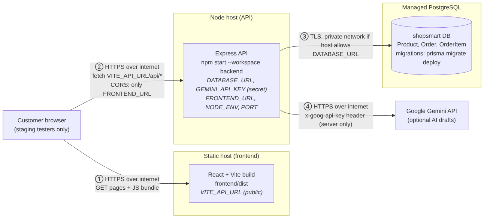
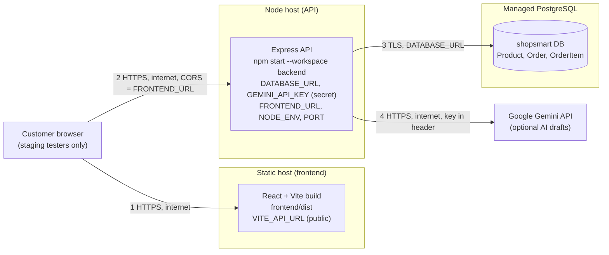

# ShopSmart Deployment Plan (private staging)

**Status:** plan only. No hosting or cloud database has been approved for this class yet, so this release is **local only**. When a platform is approved, fill in the `<…>` values below and check every command against that platform's current documentation before running it.

## Diagram

| # | Connection | Crosses the internet? | What protects it |
| --- | --- | --- | --- |
| 1 | Browser → static host | Yes | HTTPS from the host |
| 2 | Browser → API | Yes | HTTPS; CORS only allows `FRONTEND_URL`; input checked with Zod; rate limit on the assistant |
| 3 | API → PostgreSQL | Yes, unless the host offers a private network between API and database | TLS (`sslmode=require`); password only inside `DATABASE_URL` on the API host |
| 4 | API → Gemini | Yes | HTTPS; key sent in the `x-goog-api-key` header from the server only; only public product fields are sent; emails and phone numbers in questions are removed first |

The browser never talks to the database or to Gemini directly.

## Configuration by service

| Service | Setting | Value (staging) | Public or secret? | Where it is stored |
| --- | --- | --- | --- | --- |
| Frontend | `VITE_API_URL` | `https://<api-host>/api` | **Public**: Vite copies every `VITE_` variable into the browser bundle | Static host's build environment settings |
| API | `DATABASE_URL` | `postgresql://<user>:<password>@<db-host>:5432/<db>?schema=public&sslmode=require` | **Secret** | API host's environment variables (encrypted settings), never in Git |
| API | `GEMINI_API_KEY` | key from Google AI Studio (separate staging key) | **Secret** | API host's environment variables only |
| API | `GEMINI_MODEL`, `GEMINI_TIMEOUT_MS` | same as local (`.env.example`) | Not secret | API host's environment variables |
| API | `FRONTEND_URL` | `https://<frontend-host>` (exact origin: https, no path, no trailing slash) | Not secret | API host's environment variables |
| API | `NODE_ENV` | `production` | Not secret | API host |
| API | `PORT` | given by the host | Not secret | API host (the code already reads `process.env.PORT`) |

## Answers to the challenge questions

**1. Where will the Vite build files be hosted? Which URL will the frontend use for the API?**
On a static-site host (for example Render Static Site, Netlify, or S3 + CloudFront, depending on what is approved). Build command: `npm ci && npm run build --workspace frontend`; publish folder: `frontend/dist`. `VITE_API_URL` is set to `https://<api-host>/api` **before** the build, because Vite writes it into the bundle at build time. Add a rewrite rule `/* → /index.html`: the app uses React Router, so opening `/cart` directly would otherwise give the host's 404 page.

**2. Where will the Express server run, and what public URL will serve /api/health?**
On a Node.js 22 web service (for example Render Web Service, Railway, or an EC2/Elastic Beanstalk instance). Build: `npm ci && npm run db:generate`. Start: `npm start --workspace backend` (plain `node`, no `--watch`). Health check URL: `https://<api-host>/api/health` → `{"status":"ok"}`; set it as the host's health-check path.

**3. Where will PostgreSQL run, and how will the server receive DATABASE_URL securely?**
On a managed PostgreSQL 16+ service (for example Render PostgreSQL, Neon, or Amazon RDS). The connection string is pasted only into the API host's secret environment settings. It is never in the repository, the frontend, screenshots or chat. Use a database user that owns only the ShopSmart database, and require TLS.

**4. Which origin will be permitted by FRONTEND_URL and the API CORS configuration?**
Only the staging frontend origin, for example `https://<frontend-host>`. `app.js` passes `FRONTEND_URL` to `cors()`, so other sites get no `Access-Control-Allow-Origin` match (local check SEC-01 confirmed this for `http://localhost:5173`). The value must match exactly: no trailing slash, same `https`.

**5. Where will a provider key be stored, and how will it be kept out of the bundle and repository?**
Only in the API host's secret environment variables as `GEMINI_API_KEY`. It is read only in `backend/src/services/aiProvider.js`. It is not a `VITE_` variable, so Vite never puts it in the bundle. `.env` is in `.gitignore`. Checked on this release: the built `frontend/dist` contains neither the key, the database password, `GEMINI`, `DATABASE_URL` nor `postgresql://`; the only API value in it is `localhost:3000/api`. `git ls-files` shows only the two `.env.example` files, and the key does not appear anywhere in Git history.

**6. How will migrations be applied before first use, without wiping existing orders?**
- The repository now contains `backend/prisma/migrations/0_init` (defect D3 fix).
- On deploy, before the new API version starts, run `npm run db:deploy` (= `prisma migrate deploy`). It applies only committed migrations that have not run yet. It never resets the database and never deletes rows.
- **Never** run `npm run db:migrate` (`prisma migrate dev`, a development command that can offer to reset) or `prisma migrate reset` against staging.
- **Seeding:** `npm run db:seed` deletes all orders and products before inserting samples. Run it **once only**, on the brand-new, empty staging database, right after the first `db:deploy`. After the first order exists, never run it again.
- **Existing database created before this release** (any teammate's local DB): run `npx prisma migrate resolve --applied 0_init` once from `backend/`. Do not run `migrate dev` first: Prisma would see tables without migration history and offer to reset them.
- Before every future migration, back up the staging database or take a snapshot.

**7. Who can access the staging app, and will only fictional data be used?**
Only the team and the instructor. ShopSmart has **no sign-in and no access control**, so staging must not be a public shop:
- Turn on the host's password protection or IP allow-list if it has one; otherwise share the URL only with the instructor and team and take the site down after grading.
- Only fictional names, `@example.com` emails and fictional addresses. The footer already says "Simulated purchases only" and no payment is collected.
- Do not advertise the URL or connect a custom domain.

## Before staging goes live (checklist)

- [ ] Platform approved by the instructor; fill in the `<…>` values.
- [ ] Add `app.set('trust proxy', 1)` in `backend/src/app.js` (hosts sit behind a proxy; without it the assistant rate limit sees one IP for everyone). See limitation L6.
- [ ] Use a separate Gemini key for staging, with a spending limit.
- [ ] `npm run db:deploy` succeeded; `npm run db:status` says up to date.
- [ ] Seed only if the database is empty.

## Staging smoke test (repeat after each deploy)

| # | Check | Pass condition |
| --- | --- | --- |
| 1 | `https://<api-host>/api/health` | `{"status":"ok"}` |
| 2 | `https://<api-host>/api/products` | 6 products (or the current catalog) |
| 3 | Open `https://<frontend-host>`; DevTools → Network | Product cards load; requests go to `https://<api-host>/api/...`, no CORS error |
| 4 | Add a product, change quantity | Totals correct |
| 5 | Simulated checkout with fictional details | Order number shown |
| 6 | Assistant: "Which keyboard is below ₱2,000?" | Keyboard ₱1,850 with a source |
| 7 | Run smoke test again a day later | Earlier order numbers still increase from the last one (no reseed) |

Record the date, both URLs and the result in the release note. Blur or crop any screenshot that shows a dashboard with secrets.
